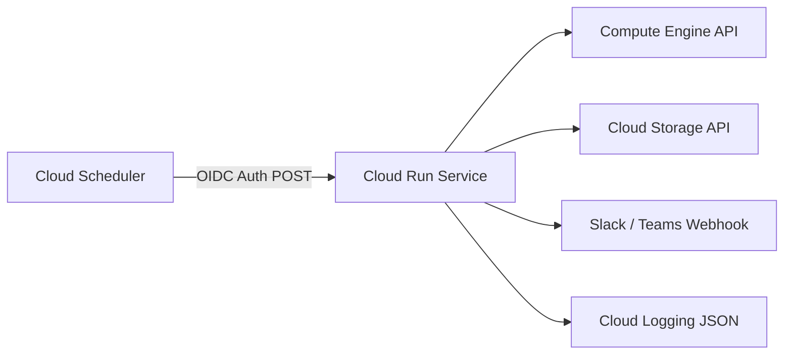

## Architecture

### Execution Flow
1. **Trigger**: Cloud Scheduler fires weekly, generating an OIDC token matching the Invoker Service Account.
2. **Compute**: Cloud Run executes `main.py`, invoking `GCPHygieneScanner`.
3. **Audit**: `scanner.py` queries Compute Engine and Cloud Storage aggregated endpoints in read-only mode.
4. **Valuation**: `CostEngine` maps detected ghost assets to standard monthly recurring unit pricing ($/GB, $/mo).
5. **Egress**: Outputs formatted Slack cards to a target webhook and dumps structured JSON findings to Cloud Logging.

flowchart TD
    subgraph TriggerPlane ["1. Trigger Plane"]
        Scheduler["⏰ Cloud Scheduler <code>weekly-hygiene-scan</code>"]
        InvokerSA["🔑 Invoker Service Account <code>roles/run.invoker</code>"]
    end

    subgraph ExecutionPlane ["2. Serverless Execution Plane (Cloud Run)"]
        CloudRun["🚀 Cloud Run Container <code>main.py (Flask + Gunicorn)</code>"]
        ScannerEngine["⚙️ Scanner Engine <code>scanner.py</code>"]
        CostEngine["💰 FinOps Cost Engine <code>MRC Unit Rates</code>"]
        RuntimeSA["🛡️ Scanner Service Account <code>roles/compute.viewer</code> <code>roles/storage.viewer</code>"]
    end

    subgraph TargetPlane ["3. Cloud Infrastructure Inspection (GCP APIs)"]
        ComputeAPI["🖥️ Compute Engine API"]
        Disks["💾 Persistent Disks <i>Unattached Zonal & Regional</i>"]
        StaticIPs["🌐 Static External IPs <i>Unattached Reserved Addrs</i>"]
        VMs["🛑 Compute Instances <i>Halted (TERMINATED) VMs</i>"]

        StorageAPI["🪣 Cloud Storage API"]
        Buckets["🔓 GCS Buckets <i>Public IAM & CMEK Status</i>"]
    end

    subgraph EgressPlane ["4. Reporting & Dispatch Plane"]
        Webhook["💬 Chat Webhooks <code>Slack / Discord / Teams</code>"]
        Logs["📋 Observability <code>Cloud Logging (Structured JSON)</code>"]
    end

    Scheduler -- "HTTP POST (OIDC Auth)" --> CloudRun
    InvokerSA -. "Signs Identity Token" .-> Scheduler
    CloudRun --> ScannerEngine
    RuntimeSA -. "Grants Read Access" .-> ScannerEngine
    ScannerEngine <--> CostEngine

    ScannerEngine -- "compute.disks.aggregatedList" --> ComputeAPI
    ScannerEngine -- "compute.addresses.aggregatedList" --> ComputeAPI
    ScannerEngine -- "compute.instances.aggregatedList" --> ComputeAPI
    ComputeAPI --> Disks
    ComputeAPI --> StaticIPs
    ComputeAPI --> VMs

    ScannerEngine -- "storage.buckets.list & getIamPolicy" --> StorageAPI
    StorageAPI --> Buckets

    ScannerEngine -- "Markdown Summary Block" --> Webhook
    ScannerEngine -- "JSON Payload" --> Logs